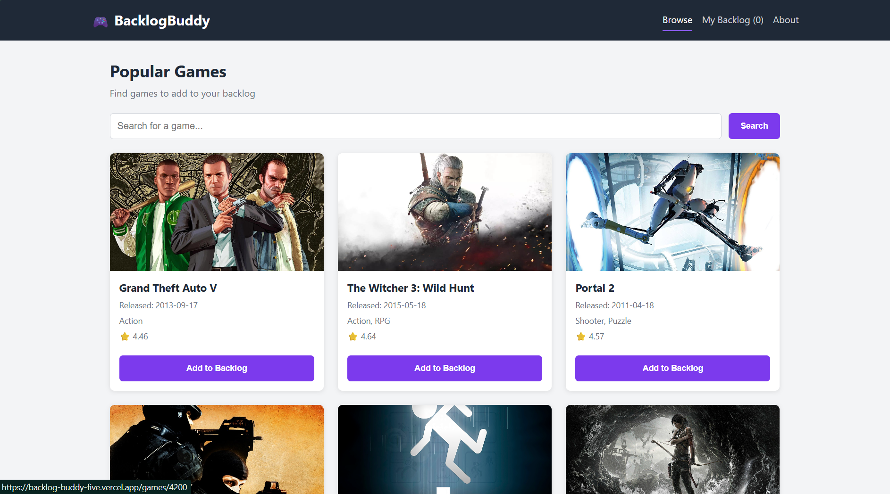
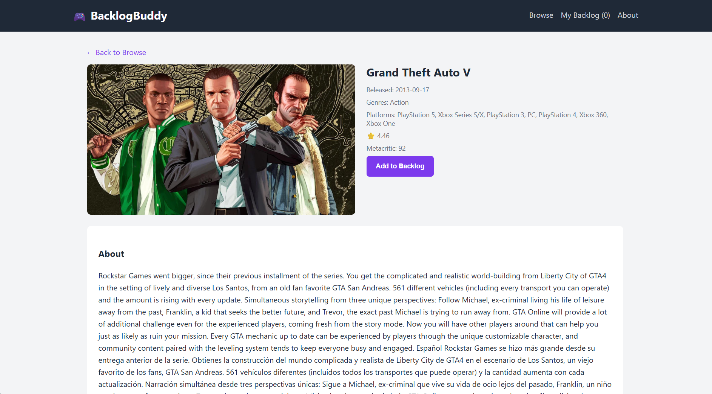
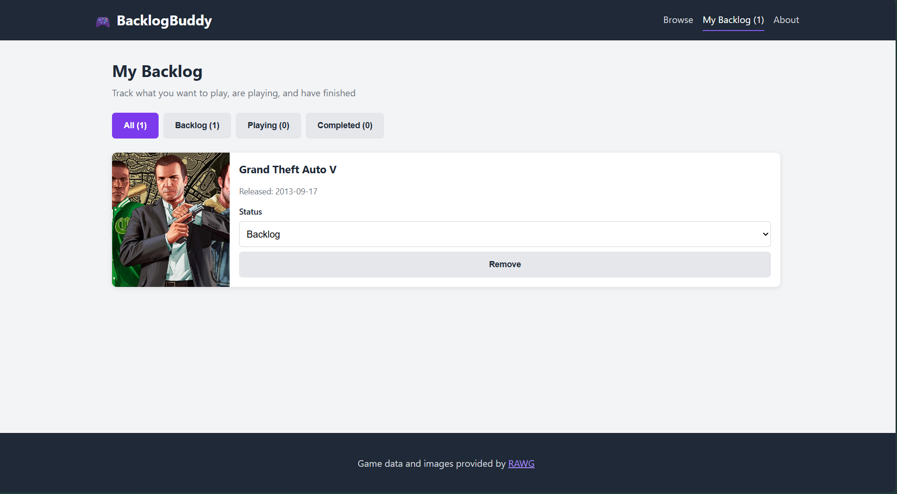
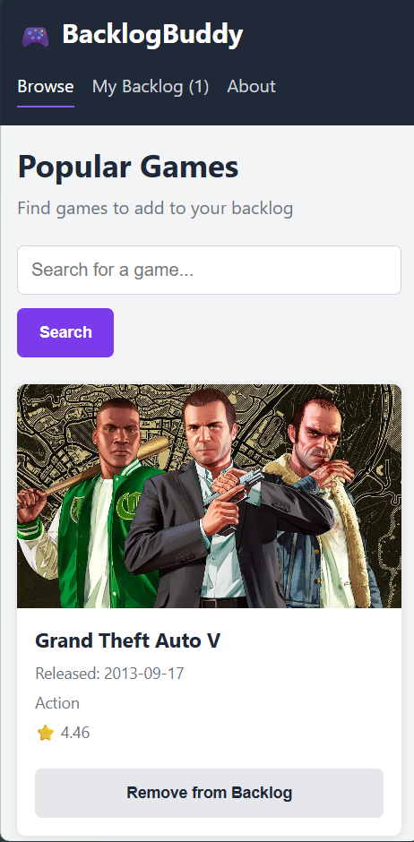

# BacklogBuddy

BacklogBuddy is a single-page React app for managing a video game backlog. Search for games, view their details, add them to your backlog, and track each one as Backlog, Playing, or Completed.

**Live site:** https://backlog-buddy-five.vercel.app/backlog

This is the MVP for my front-end development final project. Game data comes from the [RAWG Video Games Database API](https://rawg.io/apidocs).

## Screenshots

| Home | Game Details |
| --- | --- |
|  |  |

| My Backlog | Mobile View |
| --- | --- |
|  |  |

## Technologies Used

- React (Vite)
- React Router
- React Context API
- RAWG API
- Vitest and React Testing Library
- CSS (mobile-first, flexbox and media queries)
- Vercel for deployment

## Setup and Installation

1. Clone the repository:
   ```
   git clone https://github.com/DuncanMcGehee/BacklogBuddy.git
   cd backlogbuddy
   ```
2. Install dependencies:
   ```
   npm install
   ```
3. Get a free API key at [rawg.io/apidocs](https://rawg.io/apidocs).
4. Create a `.env` file in the project root:
   ```
   VITE_RAWG_API_KEY=6acddee30cee45428f6d426544b08f9a
   VITE_RAWG_BASE_URL=https://api.rawg.io/api
   ```
5. Start the development server:
   ```
   npm run dev
   ```
6. Run the tests:
   ```
   npm test
   ```

## Routes and Features

| Route | Description |
| --- | --- |
| `/` | Browse popular games and search by name |
| `/games/:id` | Game details (genres, platforms, rating, description) with Add to Backlog |
| `/backlog` | Your saved games, filtered by status, with status changes and removal |
| `/about` | About the app and the RAWG credit |
| `*` | 404 Not Found page |

Features:
- Search RAWG's game database
- Loading and error states for every API request
- Add and remove games from your backlog
- Set each game's status to Backlog, Playing, or Completed, and filter by status
- Backlog saved in the browser with `localStorage`
- Responsive layout for mobile, tablet, and desktop

## State Management

- **Local state (`useState`):** search input, fetch results, loading and error state, and the status filter.
- **Global state (Context API):** `BacklogContext` holds the backlog entries and the functions to add, remove, and update them. It is available to every page and to the header's backlog count.

## API Documentation

This app uses the [RAWG API](https://rawg.io/apidocs) with an API key sent as the `key` query parameter. The free plan allows about 20,000 requests per month.

| Function | Endpoint | Used for |
| --- | --- | --- |
| `getPopularGames()` | `GET /games?ordering=-added&page_size=20` | Home page |
| `searchGames(query)` | `GET /games?search=QUERY&page_size=20` | Search |
| `getGameById(id)` | `GET /games/{id}` | Details page |

Game data and images are provided by RAWG, and every page links back to RAWG in the footer.

## Project Structure

```
src/
  components/   Reusable UI (Header, Footer, GameCard, GameGrid, BacklogItem, ...)
  pages/        One component per route
  context/      BacklogContext
  services/     RAWG API functions
  utils/        Shared constants
```

## Deployment

The app is deployed on Vercel and redeploys automatically on every push to `main`.

To deploy your own copy:
1. Import the repository into Vercel.
2. Add the environment variables `VITE_RAWG_API_KEY` and `VITE_RAWG_BASE_URL` in the project settings.
3. Deploy. The included `vercel.json` rewrites all routes to `index.html` so refreshing on any route works.

## Known Issues

- The backlog is saved only in the browser's `localStorage`, so it does not sync across devices or browsers.
- There is no login yet, so anyone using a given browser shares the same backlog.
- Vite environment variables are included in the built JavaScript, so the RAWG API key is visible in the browser. A backend proxy will fix this in the final version.
- Search shows only the first 20 results, with no pagination.
- Game descriptions come directly from RAWG and may be missing for some games.

## Future Enhancements (Final Submission)

- User registration and login with protected routes
- Per-user backlogs and an admin role with a staff picks feature
- A Node/Express backend with a database for real authentication and storage
- Server-side caching of RAWG requests and a hidden API key
- Pagination, plus sorting and filtering by genre or platform
- More comprehensive tests

## Author

Duncan McGehee
